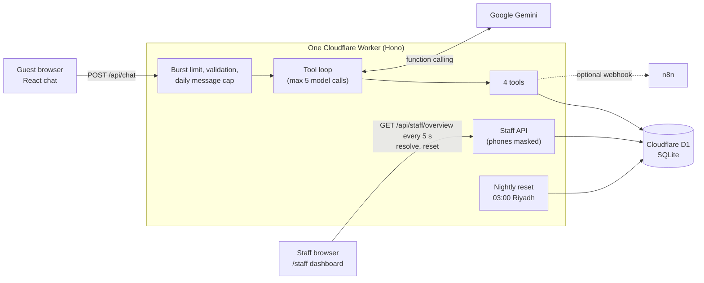
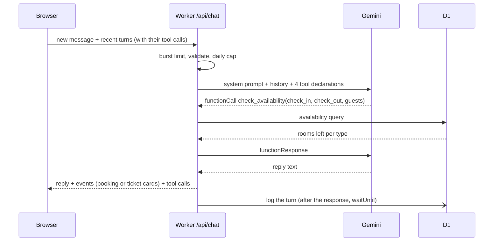

# Architecture

How the Sahil Demo Hotel receptionist works, and why it is built this way.
The hotel is fictional; see the [README](README.md) for what the demo does and how to run it.
The full decision log is in [docs/PLAN.md](docs/PLAN.md).

## The big picture

One Worker serves everything: the React app as static assets, the JSON API under `/api`, and a
`scheduled()` handler for the nightly reset. The Cloudflare Vite plugin runs the same Worker code
in `npm run dev`, so local development uses the real runtime (workerd) and a local D1 database.

## A chat turn, step by step

1. **Burst limit.** Cloudflare's rate-limiting binding allows 6 messages a minute per IP. It runs
   before anything else, so a flood costs nothing.
2. **Validation by hand.** Message length, history size and the shape of earlier tool calls are
   checked in plain code. Three fields don't justify a validation library.
3. **Daily cap.** A D1 counter allows 30 messages per visitor and 150 in total per Riyadh day,
   keeping the demo inside Gemini's free tier. The upsert is a single atomic statement.
4. **Tool loop** (`worker/ai/agent.ts`). The model is called, any function calls are run, the
   results are sent back, and this repeats until the model answers in text, at most 5 times.
5. **Reply.** The browser receives the text plus structured *events* (a booking or a ticket was
   created) so it can show cards without parsing the model's words.

### The server keeps no chat state

The browser sends the recent conversation with every message, including the tool calls each
assistant turn made. The Worker replays those as real Gemini `functionCall` / `functionResponse`
parts, not as text. An early version wrote tool results into the history as text, and the model
then *imitated* that text and reported a booking it never made, with an invented reference.
Replayed calls carry Gemini's documented placeholder thought signature, since the original
signatures aren't stored.

## What is decided in code, not by the model

The model is good at language and bad at arithmetic, calendars and rules. Wherever a fact can
be computed, it is computed and handed to the model, or the rule is enforced in the tool.

| Concern | How it's handled |
|---|---|
| Today, tomorrow, "الخميس الجاي", "the weekend" | The system prompt contains a 15-day calendar and these phrases already resolved to dates, in Riyadh time. |
| Reply language | Detected from the guest's message in code (Arabic vs Latin letters) and stated in the prompt: "reply in English only". |
| Arabic digits (٢٢ نوفمبر) | Normalized before the model and the tools see them. |
| Prices and VAT | Integer halalas; totals and the VAT share are computed by the tools. |
| Availability | SQL over the nights of the stay: a room type is free if its busiest night still has a room. |
| Two guests, one last room | The availability check and the insert are one `INSERT … SELECT` statement, so they can't both succeed. |
| "Book it" before the guest confirmed | `create_booking_hold` needs `guest_confirmed`, and refuses if the phone number is in the message being answered: the details can't have been read back yet. |
| Groups over 3 rooms | Refused by the tools, with a message telling the model to hand off to staff. |
| Handoff with odd arguments | Accepted anyway (unknown reason becomes `other`): the safety net must not fail on a detail. |
| Tool errors | Returned to the model as results with a `message` saying what to do next, never thrown. |

### The four tools

| Tool | Does |
|---|---|
| `get_hotel_info` | Returns one of 15 bilingual knowledge-base topics (rooms, check-in, parking…). The model may only state hotel facts that came from here. |
| `check_availability` | Free rooms per type for a stay, with the stay total. |
| `create_booking_hold` | Creates a hold with a reference like `SDH-N24Z`. No payment is taken. |
| `handoff_to_staff` | Opens a ticket with a reason, urgency and a summary in English and Arabic. |

## Data

D1 (SQLite) with four tables: `rooms`, `bookings`, `tickets`, `conversations`, plus
`usage_counters` for the daily cap. Migrations are in `migrations/`. Money is stored in halalas,
dates as `YYYY-MM-DD` strings in Riyadh time, timestamps in UTC.

Tools never touch SQL directly. They use a `HotelRepository` interface with two
implementations: D1 for the Worker, and in-memory arrays for the evals and the terminal chat.
One contract test suite runs against both, so the SQL and the TypeScript can't drift apart.

The demo data is generated relative to *today*: the coming weekend always has one suite left
and the family room sold out, whatever day a visitor arrives. A Cron Trigger (00:00 UTC, 03:00
Riyadh) reseeds it every night, and the dashboard's Reset button calls the same function.

## Staff dashboard and privacy

The dashboard is public in demo mode: every visitor should be able to see a handoff arrive.
That is made safe on the server, not in the page:

- Phone numbers are masked (`+9665•••••233`), including numbers the AI copied into its summaries.
- Chat session ids are never sent.
- The two actions that change data (resolve, reset) are rate-limited per visitor.
- The reset never clears today's message counters, so it can't hand out a new AI budget.

The page polls every 5 seconds, only while its tab is visible, and reads at most 100 rows of each
kind. A staff sign-in (Firebase or Cloudflare Access) is the obvious next step for a real hotel.

The optional n8n webhook gets the full ticket, phone included, because it goes to the hotel's own
systems. It is sent after the reply with `waitUntil` and can't slow down or break the chat.
The payload is in [docs/handoff-webhook.md](docs/handoff-webhook.md).

## Front end

React, Zustand and Tailwind, no router (two pages, picked by path). Arabic and English are a
typed strings object rather than an i18n library.

- `dir` on `<html>` flips the layout; components use logical utilities (`ms-`, `me-`,
  `rounded-ee-`), so there is no Arabic-only CSS.
- Every message has `dir="auto"`: an Arabic reply reads right to left even in the English UI.
- Booking references and dates are wrapped in `<bdi>` and kept on one line, since a hyphen
  inside Arabic text otherwise splits them across lines in the wrong order.
- The API clients never throw. Every failure is a code with a message in both languages, and
  a failed guest message can be retried without being sent to the model twice.

## Testing

| Layer | How |
|---|---|
| Domain logic (dates, prices, phones, availability) | Plain unit tests. |
| Data | One contract suite run against the in-memory repository and against real D1 inside workerd (`@cloudflare/vitest-plugin`). |
| Tools and the tool loop | A scripted fake model drives `runAgent`, so the loop is tested without network calls. |
| API routes | Requests against the Hono app with a migrated D1 database. |
| Model behaviour | `npm run eval`: 25 scripted conversations against the real Gemini API, graded deterministically (no AI judge). See the README. |

## Cost and abuse controls

Everything runs on free tiers: Workers, D1, and Gemini's free API tier (`gemini-3.5-flash-lite`,
set in `wrangler.jsonc`). The limits that keep it there are the burst limiter, the daily caps,
the 5-call ceiling per turn, history trimmed to the last 12 turns, and dashboard polling that
stops in background tabs.
