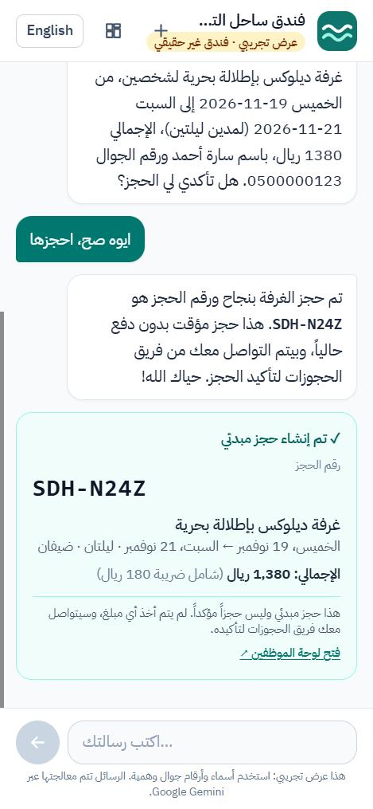
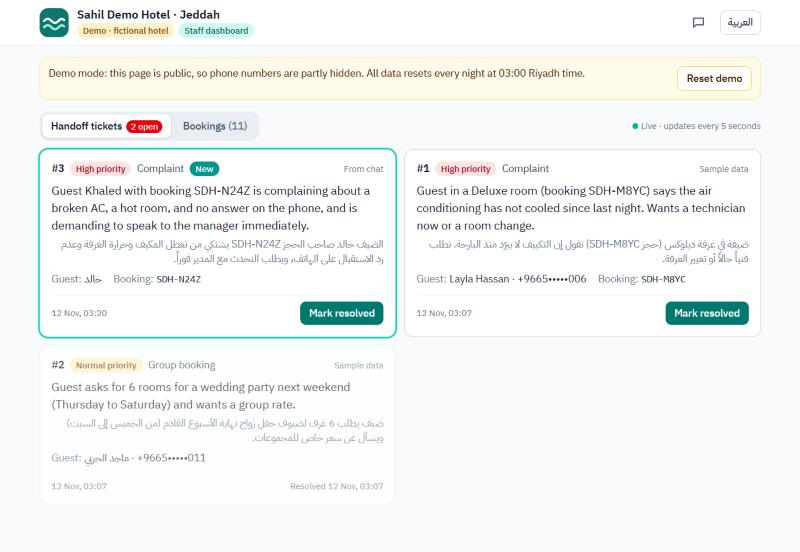
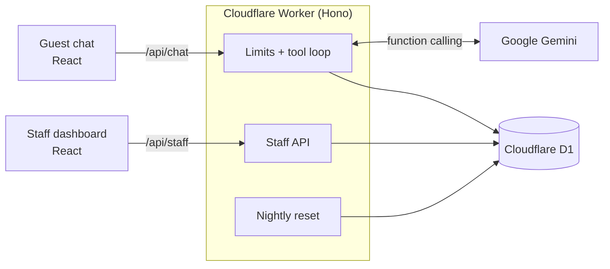

# Sahil Demo Hotel: bilingual AI receptionist (demo)

> **Demo, fictional hotel.** "Sahil Demo Hotel, Jeddah" does not exist. Every name, price, phone number and booking in this repository is made up.

An AI receptionist for a hotel in Jeddah that chats with guests in Saudi dialect (Hijazi, Najdi), formal Arabic, English, or a mix of them in one sentence. It answers questions from the hotel's knowledge base, checks which rooms are free, creates booking holds, and hands difficult conversations to staff with a summary in both languages. Staff see bookings and handoffs arrive on a live dashboard.

<p align="center">
  
  &nbsp;
  
</p>

## What it does

- **Understands how Saudi guests actually write.** "أبغى غرفة على البحر لشخصين من الخميس الجاي لين السبت" becomes a sea-view room for two, Thursday the 19th to Saturday the 21st. Arabic digits, typos and code-switching ("عندكم parking؟") are handled.
- **Answers only from the hotel's data.** Hotel facts come from a bilingual knowledge base through a tool, never from the model's imagination.
- **Books carefully.** It checks real availability, reads every detail back, and creates a hold only after the guest says yes. No payment is taken.
- **Knows when to stop.** Complaints, requests for a person, group bookings and anything outside its job go to staff as a ticket with a reason, an urgency and a summary in both languages.
- **Gives staff a live view.** `/staff` shows tickets and bookings, refreshes every 5 seconds, marks new arrivals, and lets staff resolve tickets. Phone numbers are masked because the demo dashboard is public.
- **Looks after itself.** Rate limits and daily caps keep it on free tiers, and the demo data resets every night.

## How it works



The model never touches the database. It calls four tools (`get_hotel_info`, `check_availability`, `create_booking_hold`, `handoff_to_staff`), and the rules that matter are enforced in code: dates are resolved before the model sees them, the reply language is detected, prices are computed, and a booking can't be created in the same message the guest gave their phone number. [ARCHITECTURE.md](ARCHITECTURE.md) explains each piece and why.

## Evals

25 scripted conversations ([evals/cases.json](evals/cases.json)) in English, Hijazi, Najdi, formal Arabic and mixed Arabic/English. They cover relative dates, Arabic digits, typos, FAQs, availability, full booking flows, handoffs and prompt injection. Each run uses the real Gemini API, a fresh copy of the demo hotel, and a clock frozen on one date, so "بكرة" (tomorrow) and "next Friday" have exactly one right answer. Grading is deterministic, with no AI judge: tool calls and their arguments, forbidden actions, reply language, key facts, and no invented booking reference.

| Run (`gemini-3.5-flash-lite`) | Passed | Report |
|---|---|---|
| Baseline | 20/25 | [results-baseline.md](evals/results-baseline.md) |
| After two prompt fixes | **25/25** | [results.md](evals/results.md) |

What the baseline caught, and the fixes:
- **Arabic replies to English guests** (3 cases). The guest's language is now detected in code and the prompt states it outright: "reply in English only".
- **Wrong dates** for "الويكند الجاي" (next weekend) and "next Friday" (2 cases). The prompt now includes those dates already worked out, as it already did with a calendar.

Earlier manual runs found two worse failures, now fixed in code and checked by every eval case:
- **The model invented a booking reference.** Tool results had been put back into the history as text, and the model imitated that text instead of calling the tool. Earlier tool calls are now replayed in Gemini's own function-call format.
- **The model booked before the guest confirmed.** The booking tool now refuses if the guest's phone number is in the message being answered, since the details can't have been read back yet.

Results are from single runs, and the model is not deterministic: rerun to check stability.

```bash
npm run eval                                           # all cases
npm run eval -- --only=handoff-manager-en              # some cases
npm run eval -- --model=gemini-3.8-flash --thinking=low --out=evals/results-3.8.md
```

## Stack

| Part | Choice |
|---|---|
| Front end | React, TypeScript, Vite, Tailwind CSS, Zustand. Full right-to-left support with an Arabic/English switch, mobile first. |
| Back end | One Cloudflare Worker with Hono, serving the app and `/api`. |
| Data | Cloudflare D1 (SQLite), a Cron Trigger for the nightly reset. |
| AI | Google Gemini through `@google/genai`, with function calling. Free tier. |
| Tests | Vitest with `@cloudflare/vitest-plugin`: 193 tests, including the data layer against real D1 in the Workers runtime. |

## Run it locally

Needs Node.js 24 or newer and a free Gemini API key from [Google AI Studio](https://aistudio.google.com).

```bash
npm install
cp .dev.vars.example .dev.vars   # then put your Gemini key in .dev.vars
npm run db:migrate               # create the tables in the local D1 database
npm run db:seed                  # load the demo hotel
npm test                         # run the tests (no API key needed)
npm run dev                      # http://localhost:5173 and http://localhost:5173/staff
```

Two ways to look inside without the browser:

```bash
npm run tool -- check_availability check_in=+1 check_out=+3 guests=2   # call one tool by hand
npm run chat                                                            # chat in the terminal
```

`+1` means one day from today in Riyadh. More examples are at the top of [scripts/try-tool.ts](scripts/try-tool.ts).

## Deploy your own

With a Cloudflare account (the free plan is enough):

```bash
npx wrangler login
npx wrangler d1 create ai-receptionist-db   # put the printed database_id in wrangler.jsonc
npm run db:migrate:remote
npm run db:seed:remote
npx wrangler secret put GEMINI_API_KEY
npm run deploy
```

To deploy on every push instead, connect the GitHub repository under the Worker's Settings → Builds, with `npm run build` as the build command and `npx wrangler deploy` as the deploy command. Optionally, set `N8N_WEBHOOK_URL` to get every handoff in n8n ([payload](docs/handoff-webhook.md)).

## What I'd build next

- **Staff sign-in** (Firebase Auth or Cloudflare Access), so staff see full phone numbers and every resolve is attributed to a person.
- **WhatsApp as a channel.** Most Saudi guests would rather message a hotel on WhatsApp than open a website; the tool loop doesn't care where the message comes from.
- **The conversation behind each ticket**, shown on the dashboard so staff don't have to ask the guest to repeat themselves.
- **Voice notes**, sent to Gemini as audio, with spoken replies through the browser's speech synthesis.
- **Real systems behind the tools:** a property-management system for rooms and rates, and a payment link to turn a hold into a confirmed booking.
- **Evals in CI**, run several times per case to measure stability, with more dialects (Gulf, Egyptian, Levantine) and harder multi-turn cases.
- **Streaming replies**, so long answers start appearing straight away.

## Project layout

```
src/                 React app: pages/GuestChat, pages/StaffDashboard, components, i18n strings
worker/              The Cloudflare Worker
  ai/                System prompt, Gemini adapter, tool loop
  tools/             The four tools the model can call
  data/              Repository (D1 and in-memory), knowledge base, seed data, nightly reset
  domain/            Dates, prices, availability, phone numbers
  routes/            /api/chat and /api/staff
shared/              Types used by both the browser and the Worker
migrations/          D1 schema
evals/               Eval cases, grader and results
docs/                Plan and decision log, webhook payload, demo-video script
```
